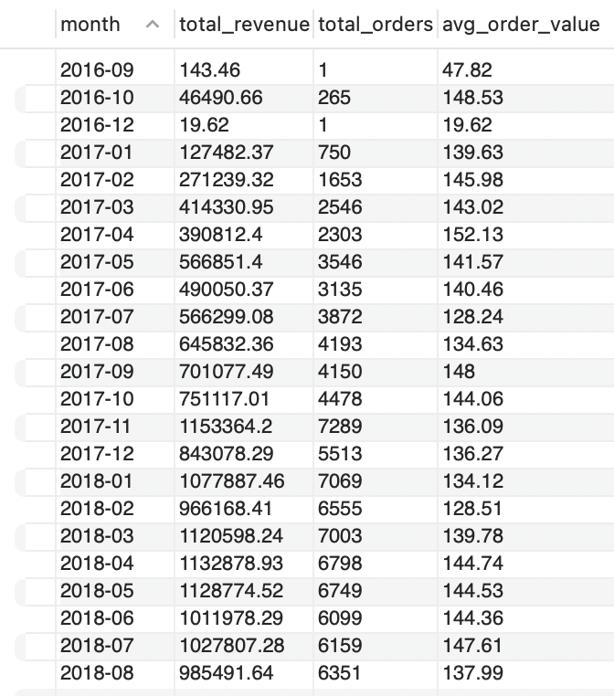
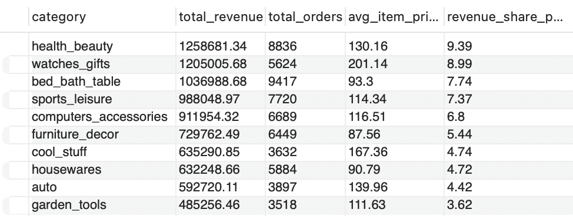
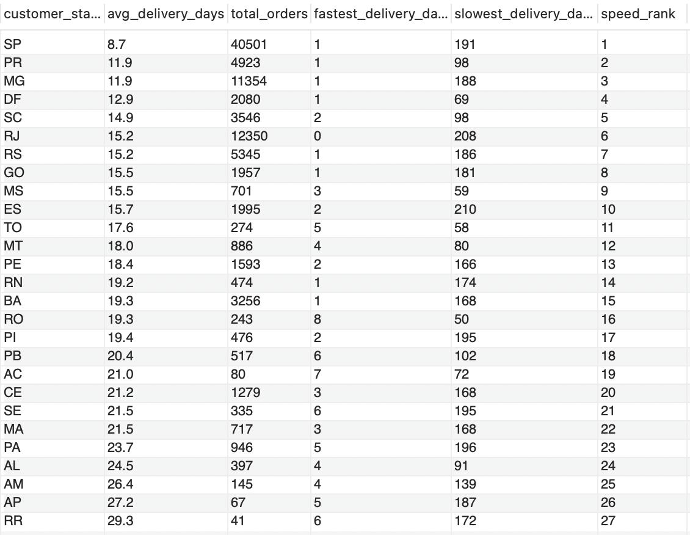
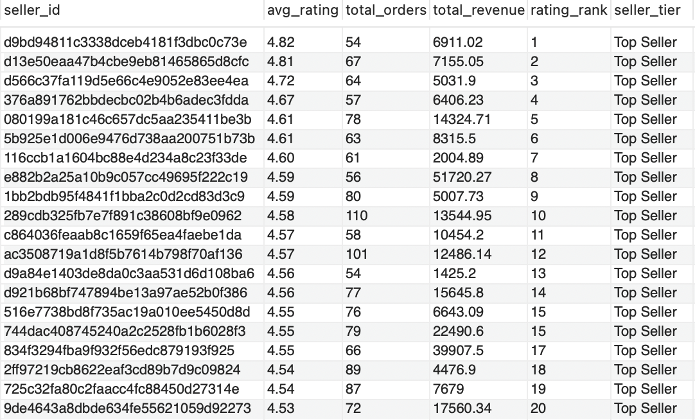
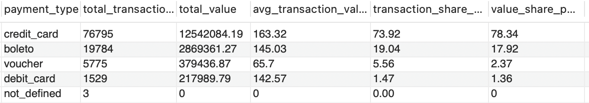
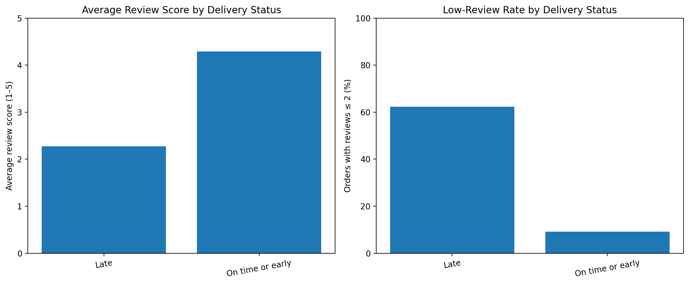

# E-Commerce Operations Analysis — SQL & Python

## Project Overview
Comprehensive analysis of approximately 100,000 orders from Olist, a Brazilian e-commerce marketplace. Combining SQL-based business analysis with Python statistical testing to investigate revenue trends, category performance, delivery efficiency, seller quality, payment behaviour, and customer satisfaction across 2016–2018.

**Dataset Size:** ~100,000 orders | 8 tables | 2016–2018 data  
**Analysis Coverage:** Revenue trends · Category performance · 
Delivery efficiency · Seller quality · Payment behaviour

## Tools & Technologies

- **Database:** MySQL 8.0
- **Query Tool:** MySQL Workbench
- **Programming Language:** Python
- **Data Analysis:** Pandas
- **Statistical Testing:** SciPy (Mann–Whitney U test)
- **Data Visualisation:** Matplotlib
- **Development Environment:** Jupyter Notebook
- **Dataset:** [Brazilian E-Commerce (Olist) — Kaggle](https://www.kaggle.com/datasets/olistbr/brazilian-ecommerce)
- **Data Cleaning:** Python

## Database Schema — 8 Tables

| Table | Rows |
|---|---|
| orders | 99,441 |
| customers | 99,441 |
| order_items | 112,650 |
| order_payments | 103,886 |
| order_reviews | 99,172 |
| products | 32,340 |
| sellers | 289 |
| category_translation | 71 |

---

## Analysis 1 — Monthly Revenue Trend

**Business Question:** How did revenue grow over time and are there 
seasonal patterns?

**Key Findings:**
- Revenue grew nearly **9x in 15 months** — from R$127,482 (Jan 2017) 
  to R$1,132,878 (Apr 2018)
- **November 2017 peaked at R$1,153,364** — a 53% spike vs October, 
  clearly driven by Black Friday
- Average order value stayed stable at R$128–R$152 throughout the 
  entire period — growth was driven purely by **customer volume, 
  not price increases**
- From Jan–Aug 2018, revenue consistently exceeded R$966,000 per month, 
  indicating the platform reached sustainable maturity

---

## Analysis 2 — Top Product Categories by Revenue

**Business Question:** Which categories drive the most revenue and 
how do their strategies differ?

**Key Findings:**
- **Health & Beauty** is the #1 category at R$1,258,681 (9.39% 
  revenue share)
- Top 3 categories account for **26.1% of total revenue** across 
  70+ categories
- Watches & Gifts achieves similar revenue to Bed Bath & Table with 
  40% fewer orders — a clear **premium pricing vs volume** contrast
- cool_stuff ranks only 7th in revenue but has the 2nd highest avg 
  item price (R$167.36) — an underexploited high-margin category

---

## Analysis 3 — Delivery Performance by State

**Business Question:** Which states have the best and worst delivery 
performance, and what drives the difference?

**Key Findings:**
- São Paulo (SP) ranks #1 fastest at **8.7 days average** and handles 
  40,501 orders — **42% of all platform deliveries**
- Roraima (RR) averages **29.3 days** — a **3.4x delivery gap** 
  between the fastest and slowest states
- Clear North-South divide: all top 10 fastest states are in 
  South/Southeast Brazil; all bottom 5 are in North/Northeast
- Rio de Janeiro shows a 0-day minimum delivery — a data anomaly 
  worth investigating for data quality review

---

## Analysis 4 — Seller Performance Ranking

**Business Question:** Who are the top-performing sellers and does 
customer rating correlate with revenue?

**Key Findings:**
- Every seller with 50+ orders achieved a "Top Seller" rating above 
  4.5 — indicating strong platform quality standards
- The #1 rated seller (4.82) generated only R$6,911 vs the #8 rated 
  seller's R$51,720 — **rating and revenue are not correlated**
- Revenue among equally-rated Top Sellers ranges from R$1,425 to 
  R$51,720 — a **36x difference** — volume strategy matters far 
  more than rating for revenue generation

---

## Analysis 5 — Payment Method Analysis

**Business Question:** How do customers prefer to pay and what does 
each method reveal about buyer behaviour?

**Key Findings:**
- Credit card dominates with **73.92% of transactions** and **78.34% 
  of total value** — R$12,542,084 of total platform revenue
- Credit card's value share (78.34%) exceeds its transaction share 
  (73.92%) — credit card users spend **disproportionately more** 
  per order (R$163.32 avg)
- Voucher users average only R$65.70 per order — less than half 
  the credit card average — indicating discount-driven, low-value 
  purchasing behaviour
- Debit card accounts for just 1.47% of transactions — significantly 
  underutilised compared to credit card
- 3 transactions flagged as "not_defined" with R$0 value — minor 
  data quality issue documented

---

## Analysis 6 — Delivery Delays and Customer Reviews

**Business Question:** Are late deliveries associated with lower customer review scores?

**Key Findings:**
- Among delivered orders with valid delivery and estimated dates, 6,534 were late and 89,936 were delivered on time or early.
- Late-delivery orders had an average review score of **2.27/5**, compared with **4.29/5** for on-time-or-early orders.
- **62.33%** of reviewed late-delivery orders had an average review score of 2 or lower, versus **9.22%** for on-time-or-early orders.
- Late orders arrived an average of **10.6 days after** the estimated date. Orders delivered on time or early arrived an average of **13.5 days before** the estimated date.

**Business Implication:** Delivery reliability is a strong candidate for operational improvement because late deliveries are associated with substantially worse customer feedback.

**Limitation:** These results show an association, not proof that delivery delays alone cause poor reviews. Orders without valid delivery or estimated dates were excluded.

SQL file: `05_delivery_review_impact.sql`

---

## Analysis 7 — Seller Delivery Performance Scorecard

**Business Question:** Which sellers should be prioritised for delivery-performance improvement?

**Key Findings:**
- The scorecard evaluates sellers with at least **50 delivered orders** and returns the 25 sellers with the highest late-delivery percentages.
- The highest-ranked seller in this result set had **22 late deliveries out of 73 orders**, a late-delivery rate of **30.14%**.
- This seller had an average review score of **3.14/5**, with **40.58%** of reviewed orders receiving an average score of 2 or lower.
- Another seller had 389 delivered orders and 74 late deliveries, a **19.02%** late-delivery rate. Its larger delivery volume makes it worth investigating alongside the highest-rate sellers.

**Business Recommendation:** Investigate logistics, dispatch processes and estimated delivery accuracy for sellers with both elevated delay rates and poor review outcomes. Prioritise high-volume sellers where delays affect more orders.

**Limitation:** Reviews are recorded at order level. If an order contains products from multiple sellers, its review score is attributed to each seller involved. These results are an operational screening tool, not proof that an individual seller caused a poor review.

SQL file: `06_seller_delivery_scorecard.sql`

---

---

## Analysis 8 — Python Statistical Analysis: Delivery Delays and Customer Satisfaction

**Business Question:** Are late deliveries associated with significantly lower customer review scores?

**Tools:** Python, Pandas, SciPy, Matplotlib

**Analysis Methodology:**
- Loaded and cleaned the Olist orders and reviews datasets using Pandas.
- Analysed 96,470 delivered orders with valid delivery dates.
- Aggregated customer reviews to one average review score per order.
- Classified orders as late or on time/early based on actual versus estimated delivery dates.
- Used the Mann–Whitney U test to compare review-score distributions between delivery groups.

**Key Findings:**
- Late deliveries received an average review score of **2.27/5**, compared with **4.29/5** for on-time or early deliveries.
- Median review scores were **1 star for late deliveries** and **5 stars for on-time/early deliveries**.
- **62.36%** of reviewed late-delivery orders received average scores of 2 or lower, compared with **9.23%** of on-time/early orders.
- The Mann–Whitney U test indicated a statistically significant difference between the two groups (**p < 0.001**).

**Business Implication:** Delivery reliability is an important area for operational improvement. Late deliveries are strongly associated with lower customer satisfaction and a higher proportion of poor reviews.

**Data Quality Limitation:** The original review CSV contained 99,224 records, whereas the MySQL table contained 99,172. The Python analysis uses the original CSV. Eight delivered orders with missing actual delivery dates were excluded. Results demonstrate association, not causation.

**Visualisation:**

**Python Notebook:** `notebooks/07_delivery_review_statistical_analysis.ipynb`

---
## How to Reproduce
1. Download the dataset from the Kaggle link above
2. Create a MySQL database: `CREATE DATABASE olist_ecommerce;`
3. Import all 8 CSV files using MySQL Workbench Table Data Import Wizard
4. Run queries in numbered order from this repository
5. Note: `olist_order_reviews_dataset.csv` requires UTF-8 encoding 
   fix before import — use the Python script approach if the wizard 
   throws an encoding error
   
## SQL Techniques Used
| Technique | Where Applied |
|---|---|
| INNER JOIN (multi-table) | Queries 1, 2, 3, 4 |
| Aggregation (SUM, COUNT, AVG, MIN, MAX) | All queries |
| Window Functions — RANK() OVER | Queries 3, 4 |
| Window Functions — SUM() OVER for % | Queries 2, 5 |
| CASE statement (tiering/classification) | Query 4 |
| DATE_FORMAT | Query 1 |
| DATEDIFF | Query 3 |
| HAVING clause | Query 4 |

## Files
- `01_monthly_revenue_trend.sql`
- `02_category_performance.sql`
- `03_delivery_performance.sql`
- `04_seller_ranking.sql`
- `05_payment_analysis.sql`
- `01_monthly_revenue.png`
- `02_category_performance.png`
- `03_delivery_performance.png`
- `04_seller_ranking.png`
- `05_payment_analysis.png`
- `05_delivery_review_impact.sql`
- `06_seller_delivery_scorecard.sql`
- `notebooks/07_delivery_review_statistical_analysis.ipynb`
- `reports/figures/06_delivery_review_comparison.png`
